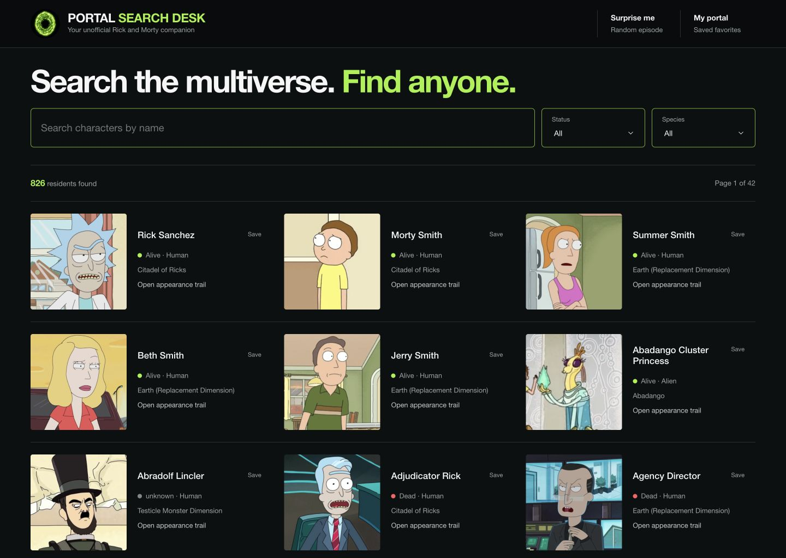

# Portal Search Desk

An Angular and GraphQL companion for Rick and Morty fans who want to identify a character, trace their episode appearances, or pick something to rewatch.

The product is intentionally more than an API gallery: character search leads into appearance trails, episode pages reveal their full cast, “Surprise me” removes rewatch indecision, and favorites make the experience useful across visits.



## What it demonstrates

- Angular 11 routing, reactive forms, responsive components, and explicit loading/error states
- Apollo Client querying a real public GraphQL endpoint directly
- GraphQL variables, fragments, filters, nested relationships, and Apollo caching
- Character → episode → cast navigation through a connected data graph
- Browser-local favorites without accounts or collection of personal data

Data and images come from the public [Rick and Morty GraphQL API](https://rickandmortyapi.com/documentation/#graphql) at `https://rickandmortyapi.com/graphql`.

## Run locally

Use Node 16.20.2:

```bash
nvm use
npm ci
npm run dev
```

Open `http://localhost:4200/`.

## Verify

```bash
npm run lint
npm test -- --watch=false --browsers=ChromeHeadless
npm run build
```

The production bundle is written to `dist/rockX`.

To smoke-test the same static server used in production:

```bash
npm run build
npm start
```

The server reads Heroku's `PORT`, serves fingerprinted assets with long-lived cache headers, and falls back to `index.html` for Angular routes.

## Example GraphQL operations

```graphql
query Characters($page: Int, $filter: FilterCharacter) {
  characters(page: $page, filter: $filter) {
    info { count pages next prev }
    results {
      id
      name
      status
      species
      image
      location { name }
    }
  }
}

query CharacterDetails($id: ID!) {
  character(id: $id) {
    name
    image
    origin { name }
    location { name }
    episode { id name airDate: air_date episode }
  }
}
```

## Public API rate limits

The API documentation does not publish a guaranteed rate-limit contract, so the app treats the endpoint as a constrained public service:

- Search input is debounced and unchanged filters are ignored.
- A new filter cancels the previous observable and resets pagination without issuing a duplicate request.
- Apollo uses `cache-first` for repeated searches and detail views.
- Result-list queries fetch only the fields rendered by the cards; nested episode and cast data is loaded on detail pages.
- Failures show a quiet retry-oriented message instead of automatically creating a retry storm.

This client-side protection is appropriate for a portfolio-scale app. A higher-traffic deployment should add a small caching backend or edge proxy with request coalescing and server-side throttling.

## Product boundaries

- Favorites remain in `localStorage` on the current device.
- The app does not provide streaming links or invented episode summaries.
- Portal Search Desk is an unofficial fan project and is not affiliated with Adult Swim or the creators of Rick and Morty.
